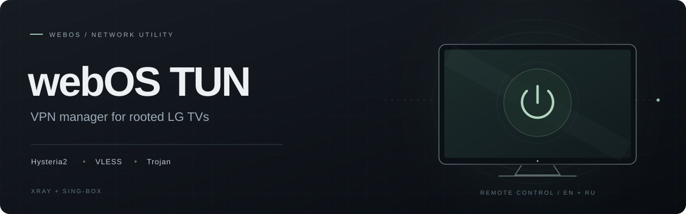
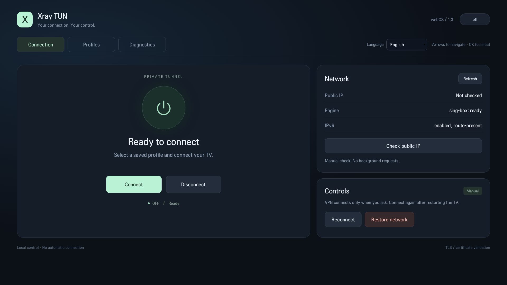

[Русский](README.ru.md) · [Builds](https://github.com/l4yw33/webos-tun/actions/workflows/build.yml) · [Changelog](CHANGELOG.md) · [Issues](https://github.com/l4yw33/webos-tun/issues)

VPN manager for rooted LG webOS TVs, using Xray and sing-box. Remote control navigation, manual connection, HTTPS subscriptions and local diagnostics. English and Russian interface.

The repository is named **webos-tun**. The existing application ID and runtime paths are retained for upgrade compatibility.

## Requirements

- Rooted LG webOS TV with the Homebrew Channel root service.
- TUN support and compatible Xray/sing-box binaries.
- Linux ARMv7 binaries for OLED55C6V. Cores are not included.

Checked on **LG OLED55C6V · webOS 3.4 · Chromium 38**. Other models require separate verification.

## Interface



<sub>Captured on LG OLED55C6V. Navigate with the remote's arrows and OK.</sub>

## Installation

1. Open the latest successful [build](https://github.com/l4yw33/webos-tun/actions/workflows/build.yml), download the **webos-tun-1.3.0** artifact and extract it. GitHub sign-in may be required.
2. Install the IPK through **webOS Dev Manager**.
3. Supply the compatible core binaries in the paths below. See [binary requirements](docs/BINARIES.md).

```text
/home/root/webos-xray-tun/bin/xray
/home/root/webos-xray-tun/bin/sing-box
```

Opening the app starts the local helper. It does not connect VPN or modify boot hooks.

## Profiles and subscriptions

| Source | Import |
| :--- | :--- |
| Proxy URL | **Profiles → Connection URLs**: paste, select, then **Save profile** |
| HTTPS subscription | **Profiles → HTTPS subscription → Update subscription**: select a server, then **Save profile** |
| Subscription file | Upload the file below, then **Load subscription file → Update subscription** |

Save profiles while VPN is disconnected. Use **Connection → Connect** to connect.

For file import, create a UTF-8 file containing only the full HTTPS URL on one line, such as `https://example.com/private-token`. Upload through Dev Manager to:

```text
/home/root/webos-xray-tun/profiles/subscription.url
```

Owner: **root**. Permissions: **0600**. The separate **Load file** button reads proxy URLs from `profiles/default.url`.

Subscriptions support plain and Base64 URL lists, including compatible Hiddify output. Updates are manual. The selected saved profile persists; the imported list lasts until the app closes. Clash YAML and sing-box JSON subscriptions are not supported.

## Protocols

| Protocol | Transport | Security |
| :--- | :--- | :--- |
| Hysteria2 | QUIC / native sing-box | TLS, optional Salamander |
| VLESS | TCP, gRPC, WebSocket, XHTTP | TLS / REALITY; Vision with TCP |
| Trojan | TCP, gRPC, WebSocket, XHTTP | TLS |

Preserve the SNI, paths and credentials exported by your provider. [Profile reference →](docs/PROFILES.md)

## Build

Windows with Node.js/npm:

```powershell
git clone https://github.com/l4yw33/webos-tun.git
cd webos-tun
./build.ps1
```

The script downloads a checksum-verified Go toolchain, runs JS/Go tests, builds the ARMv7 helper and produces `dist/com.webosbrew.xraytun_1.3.0_all.ipk`. It does not install the package on the TV. Generated binaries are excluded from source control.

## Security

The helper uses loopback, Host/Origin checks and a random process token. Subscription requests verify HTTPS certificates, reject local/private destinations and enforce time/size limits. Sensitive files use **0600**, private runtime directories **0700**.

**Limitations:** this is not a kill switch. DNS/IPv6 leak protection and VPN failure behavior are not fully verified. The system Chromium debug listener is not disabled by this app. Root processes can read credentials. **Check public IP** checks IPv4 only; with VPN OFF it shows the normal uplink address.

Never publish subscription URLs, profiles or unreviewed logs. See [security policy](SECURITY.md) and [verification notes](SUBSCRIPTIONS-SECURITY.md).

---

[Compatibility](docs/COMPATIBILITY.md) · [Troubleshooting](docs/TROUBLESHOOTING.md) · [Architecture](docs/architecture.md) · [MIT license](LICENSE)

Independent community project. Not affiliated with LG.
