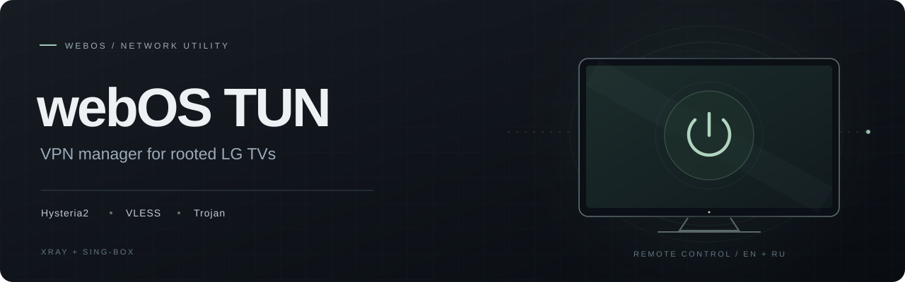
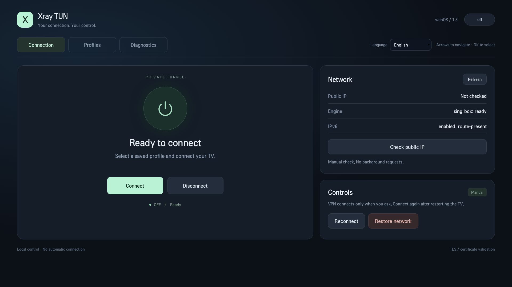

[English](README.md) · [Сборки](https://github.com/l4yw33/webos-tun/actions/workflows/build.yml) · [Изменения](CHANGELOG.md) · [Проблемы](https://github.com/l4yw33/webos-tun/issues)

VPN-менеджер для LG webOS с root-доступом. Xray и sing-box, управление с пульта, ручное подключение, HTTPS-подписки и диагностика. Английский и русский интерфейс.

Проверено на **LG OLED55C6V · webOS 3.4 · Chromium 38**.

Репозиторий называется **webos-tun**. Внутренний идентификатор приложения и пути runtime сохранены для совместимости с установленной версией.

## Интерфейс

Скриншот с LG OLED55C6V. Управление стрелками и кнопкой OK на пульте.

## Установка

> Нужны **root на телевизоре**, **root-сервис Homebrew Channel**, поддержка TUN и совместимые Xray/sing-box. Это приложение не для установки через LG Content Store.

1. Откройте [GitHub Actions](https://github.com/l4yw33/webos-tun/actions/workflows/build.yml), выберите последнюю успешную сборку.
2. Скачайте **Artifacts → webos-tun-1.3.0**, распакуйте ZIP и установите IPK через **webOS Dev Manager**. Для скачивания артефактов может потребоваться вход в GitHub.
3. Добавьте совместимые бинарники в `/home/root/webos-xray-tun/bin/xray` и `/home/root/webos-xray-tun/bin/sing-box`. Для OLED55C6V нужны **Linux ARMv7**. Ядра в комплект не входят: [требования](docs/BINARIES.md).
4. Откройте **Профили**, добавьте ссылку сервера и нажмите **Сохранить профиль** при отключённом VPN.
5. Перейдите в **Подключение → Подключить**.

## Подписки

### На телевизоре

1. Откройте **Профили → HTTPS-подписка**.
2. Введите полную ссылку: `https://example.com/private-token`.
3. Нажмите **Обновить подписку**.
4. Выберите сервер в списке и нажмите **Сохранить профиль**.
5. Перейдите в **Подключение → Подключить**.

### Через файл с компьютера

В Блокноте создайте файл **subscription.url**: одна строка с HTTPS-ссылкой, кодировка **UTF-8**, тип файла **Все файлы**, без расширения `.txt`.

Загрузите через файловый менеджер Dev Manager сюда:

~~~text
/home/root/webos-xray-tun/profiles/subscription.url
~~~

Владелец — **root**, права — **0600**. В приложении нажмите **Загрузить подписку из файла → Обновить подписку**, затем выберите и сохраните сервер.

<strong>Форматы и особенности</strong>

- Поддерживаются обычные и Base64-списки ссылок `hysteria2://`, `hy2://`, `vless://` и `trojan://`, включая совместимые подписки Hiddify.
- Clash YAML и sing-box JSON как формат подписки не поддерживаются.
- Обновление только вручную, без автоматического подключения.
- Выбранный сохранённый профиль остаётся на ТВ. Импортированный список действует до закрытия приложения.
- Ссылка скрыта точками. Часть после `#` убирается перед запросом.
- Кнопка **Загрузить файл** предназначена для другого файла: `profiles/default.url` с готовыми ссылками серверов, а не HTTPS-подпиской.

## Сборка

На Windows с установленными Node.js/npm:

~~~powershell
git clone https://github.com/l4yw33/webos-tun.git
cd webos-tun
./build.ps1
~~~

Скрипт загрузит Go с проверкой контрольной суммы, выполнит тесты, соберёт ARMv7-помощник и пакет `dist/com.webosbrew.xraytun_1.3.0_all.ipk`. На ТВ ничего не устанавливается автоматически.

## Безопасность

Проверено на **LG OLED55C6V / webOS 3.4 / Chromium 38**. Для других моделей результат зависит от версии системы и совместимости ядер.

| Защита в приложении | Ограничения |
| :--- | :--- |
| Локальный API, токен, проверка Host/Origin | Root-процессы могут читать секреты |
| HTTPS с проверкой сертификатов | Это не kill switch |
| Блокировка локальных адресов при загрузке подписки | DNS/IPv6-утечки и сбои VPN проверены не полностью |
| Закрытые права файлов и каталогов runtime | Системный порт отладки Chromium приложение не отключает |

Открытие приложения не включает VPN, установщик не меняет хуки автозапуска. **Проверка IP** показывает IPv4: при выключенном VPN это адрес обычного подключения.

Не публикуйте ссылки подписки и конфиги. Журналы перед отправкой нужно проверить. Подробнее: [политика безопасности](SECURITY.md), [границы проверки](SUBSCRIPTIONS-SECURITY.md).

---

[История изменений](CHANGELOG.md) · [Совместимость](docs/COMPATIBILITY.md) · [Сообщить о проблеме](https://github.com/l4yw33/webos-tun/issues) · [MIT](LICENSE)
